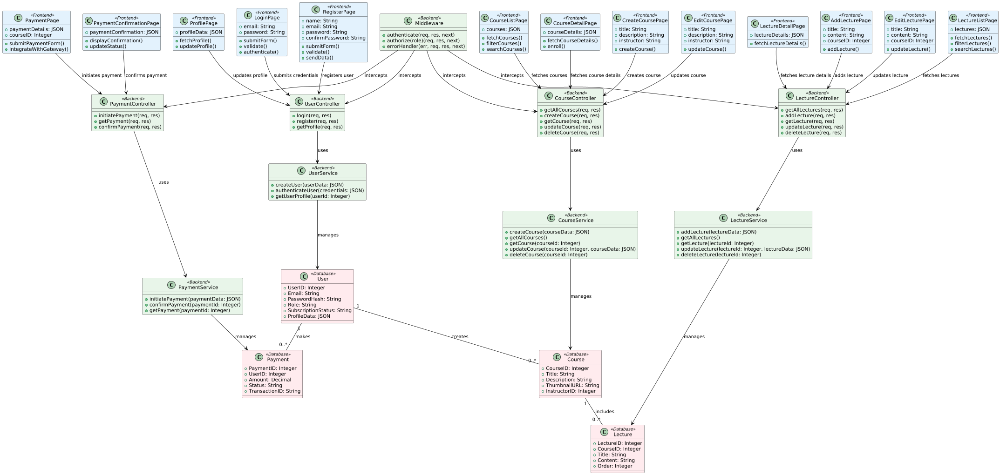

# EduNest LMS — Learning Management System

> A full-stack **MERN** Learning Management System built as a **5th Semester BCA (AI & DS) project** at **Graphic Era Hill University, Haldwani**.

<p align="center">
  <strong>Built by</strong><br/>
  <strong>Vachaspati Tiwari</strong> &nbsp;•&nbsp; <strong>Prerana Anand</strong>
</p>

---

## 📖 About the Project

**EduNest LMS** is a web-based Learning Management System that makes it easy for institutes to publish courses, for teachers to manage lectures, and for students to learn online and earn a verifiable certificate on completion.

The platform supports **three distinct roles** — **Student**, **Teacher**, and **Admin** — each with their own dashboard, permissions and workflow. Courses can be browsed publicly, unlocked through a subscription, and watched lecture-by-lecture with progress tracking.

This project was developed as part of our **5th Semester BCA (Artificial Intelligence & Data Science)** curriculum at **Graphic Era Hill University, Haldwani**, to demonstrate practical full-stack web development, authentication, role-based access control, payment integration and cloud media management.

---

## 👩‍💻👨‍💻 Project Team

| Name | Role | Institution |
| --- | --- | --- |
| **Vachaspati Tiwari** | Full-Stack Developer | Graphic Era Hill University, Haldwani |
| **Prerana Anand** | Full-Stack Developer | Graphic Era Hill University, Haldwani |

- **Course:** Bachelor of Computer Applications (BCA) — Artificial Intelligence & Data Science
- **Semester:** 5th Semester
- **Academic Year:** 2026–27

---

## ✨ Key Features

### 🔐 Authentication & Security
- JWT-based authentication stored in secure HTTP-only cookies
- Password hashing with **bcryptjs**
- Forgot password / reset password via email (**Nodemailer**)
- Change password from the profile page
- Role-based route protection on both frontend and backend
- **Public signup creates Student accounts only** — Teacher/Admin accounts are
  promoted by an administrator through the User Management panel
- **Account blocking** — admins can block or unblock any user; blocked users
  cannot log in

### 👥 Three-Role System

| Role | Capabilities |
| --- | --- |
| **Student** | Browse courses, subscribe, watch lectures, track progress, earn certificates, manage profile |
| **Teacher** | Everything a student can do **plus** create/edit courses, upload & delete lectures, view course and payment statistics |
| **Admin** | Full control — create/edit/delete courses, manage all lectures, view all users, all payments and platform statistics |

### 📚 Course Management
- Create, edit and delete courses with a thumbnail image
- Upload lecture videos and descriptions to **Cloudinary**
- Course catalog with **live search** by title, category or instructor
- Course detail page with instructor info and lecture count

### 🎓 Learning & Certificates
- In-browser video player with a clickable lecture list
- **Progress tracking** — tick each lecture as complete (`X/Y` progress bar)
- Once every lecture is completed, the student unlocks a **Certificate of Completion**
- Printable / downloadable certificate (Print → Save as PDF) with student name, course, instructor and issue date
- **My Certificates** section on the student profile to revisit earned certificates

### 💳 Subscription & Payments
- Razorpay subscription checkout for premium course access
- Server-side signature verification before activation
- **Demo mode** — if Razorpay credentials are not configured, subscriptions are activated automatically so the project can be evaluated offline
- Payment history visible to Admin and Teacher dashboards
- Dedicated success and failure checkout pages

### 📊 Dashboards
- **Admin dashboard** — platform-wide statistics, all courses, all payments and revenue charts
- **Teacher dashboard** — own courses, lectures, modules, quizzes and study materials with quick actions
- **Student profile** — subscription status, enrolled courses and earned certificates

### 🧩 Course Modules
- Teachers organise lectures into modules (chapters)
- Upload downloadable study material (PDF, PPT, notes) to each module
- Students view modules, download material and see lecture grouping on the course page
- Teachers generate a quiz for any course with one click
- Smart offline generator works with no API key (builds questions from modules and lectures)
- Automatically uses Gemini or OpenAI when an API key is configured
- Students take the quiz and receive a score with per-question explanations
- Quiz must be passed to unlock the certificate
- Modern dark theme with yellow accents using **Tailwind CSS** + **DaisyUI**
- Fully responsive layout (mobile, tablet, desktop)
- Animated landing page with hero, stats, feature cards and call-to-action
- Toast notifications, loading states and friendly empty states
- Custom `404` and `Access Denied` pages with working navigation

---

## 🛠️ Tech Stack

**Frontend**
- React 18 + Vite
- React Router DOM v6
- Redux Toolkit + React Redux
- Tailwind CSS + DaisyUI
- Axios
- React Icons
- Chart.js + react-chartjs-2
- React Hot Toast

**Backend**
- Node.js + Express.js
- MongoDB + Mongoose
- JSON Web Tokens (JWT) + bcryptjs
- Multer (file uploads)
- Cloudinary (media storage)
- Nodemailer (transactional email)
- Razorpay (subscriptions)
- CORS + cookie-parser + morgan

---

## 📂 Project Structure

```
Learning-Management-System/
├── Client/                      # React frontend (Vite)
│   ├── src/
│   │   ├── Assets/              # Images and static assets
│   │   ├── Compontents/         # Reusable UI components
│   │   │   └── Auth/            # RequireAuth route guard
│   │   ├── Layouts/             # HomeLayout, shared shell
│   │   ├── Pages/
│   │   │   ├── Course/          # Course list, description, create/edit
│   │   │   ├── Deshboard/       # Admin/Teacher dashboard, lectures
│   │   │   ├── Payment/         # Checkout, success, failure
│   │   │   ├── Password/        # Forgot / reset / change password
│   │   │   └── User/            # Profile, edit profile
│   │   ├── Redux/               # Store + API slices
│   │   ├── Helpers/             # Utility functions
│   │   └── App.jsx              # Route definitions
│   └── package.json
│
├── Server/                      # Express backend
│   ├── config/                  # DB, Cloudinary, Razorpay config
│   ├── controllers/             # Route handlers
│   ├── middlewares/             # Auth, roles, multer, error handler
│   ├── models/                  # User, Course, Payment schemas
│   ├── routes/                  # API route definitions
│   ├── utils/                   # Helpers (mail, error wrapper)
│   ├── app.js                   # Express app + CORS + middleware
│   └── server.js                # Server entry point
│
├── low-level-diagram.png        # System design diagram
└── README.md
```

---

## 🚀 Getting Started

### Prerequisites

Make sure you have the following installed / available:

- [Node.js](https://nodejs.org/) v18 or higher
- npm v9 or higher
- [MongoDB](https://www.mongodb.com/) (local instance or MongoDB Atlas connection string)
- A [Cloudinary](https://cloudinary.com/) account (for images and lecture videos)
- A [Razorpay](https://razorpay.com/) account (optional — the app falls back to demo mode)

### 1. Clone the repository

```bash
git clone <your-repository-url>
cd Learning-Management-System
```

### 2. Configure the backend

```bash
cd Server
npm install
```

Create a `.env` file inside `Server/` (a ready-to-fill template is provided at `Server/.env.example`):

```env
PORT = 5014
MONGODB_URL = <your_mongodb_connection_string>
JWT_SECRET = <a_long_random_secret>
JWT_EXPIRY = 7d

FRONTEND_URL = http://localhost:5173
CONTACT_US_EMAIL = <your_contact_email>

CLOUDINARY_CLOUD_NAME = <your_cloud_name>
CLOUDINARY_API_KEY = <your_api_key>
CLOUDINARY_API_SECRET = <your_api_secret>

SMTP_HOST = <smtp_host>
SMTP_PORT = <smtp_port>
SMTP_USERNAME = <smtp_username>
SMTP_PASSWORD = <smtp_password>
SMTP_FROM_EMAIL = <sender_email>

RAZORPAY_KEY_ID = <your_razorpay_key>
RAZORPAY_SECRET = <your_razorpay_secret>
RAZORPAY_PLAN_ID = <your_razorpay_plan_id>

# AI Quiz Generator (optional - works offline without these)
GEMINI_API_KEY = <your_gemini_api_key>
OPENAI_API_KEY = <your_openai_api_key>
OPENAI_MODEL = gpt-4o-mini
```

Start the backend:

```bash
npm run dev
```

The API will be available at **http://localhost:5014**.

### 3. Configure the frontend

Open a second terminal:

```bash
cd Client
npm install
npm run dev
```

The app will be available at **http://localhost:5173**.

### 4. Production build

```bash
cd Client
npm run build
```

---

## 🔑 Demo Accounts

These accounts were created in the development database for evaluation and demonstration.

| Role | Email | Password |
| --- | --- | --- |
| **Admin** | `testuser123@example.com` | `Test@1234` |
| **Teacher** | `teacher@example.com` | `Teacher@1234` |
| **Student** | `testuser999@example.com` | `Test@1234` |

> **Note:** Admin accounts are not created through the public signup form. New users can register as **Student** or **Teacher**; the Admin account is provisioned directly in the database for security.

---

## 🧭 How to Use (Demo Walkthrough)

1. **Sign up / Log in** as a student, teacher or admin.
2. As a **Teacher or Admin**, open the dashboard → **Create Course** → add a thumbnail, title, description and category.
3. Open a course → **Manage modules & quiz** (purple button) to create modules (chapters), upload study material (PDF/PPT/notes), and generate an AI quiz.
4. Add **lectures** to a course or to a specific module (video + description).
5. As a **Student**, go to **All Courses** → open a course → **Watch lectures**.
6. Tick each lecture as completed — the progress bar fills up, and download module study material.
7. Take the **course quiz** and pass it (required for the certificate).
8. When all lectures are complete and the quiz is passed, click **🎓 Get Your Certificate**.
9. On the certificate page, click **Print / Save as PDF** to download it.
10. Visit **Profile → My Certificates** to revisit earned certificates.
11. Admins and Teachers can review **payments and platform statistics** from the dashboard.

---

## 🔌 API Overview

All routes are prefixed with `/api/v1`.

| Method | Endpoint | Access | Description |
| --- | --- | --- | --- |
| `POST` | `/user/register` | Public | Register a new user (student/teacher) |
| `POST` | `/user/login` | Public | Log in and receive an auth cookie |
| `POST` | `/user/logout` | Private | Log out |
| `GET` | `/user/me` | Private | Get logged-in user profile |
| `PUT` | `/user/update` | Private | Update profile / avatar |
| `POST` | `/user/reset` | Public | Request password reset email |
| `POST` | `/user/reset/:resetToken` | Public | Reset password |
| `POST` | `/user/change-password` | Private | Change password |
| `GET` | `/course` | Public | List all courses |
| `POST` | `/course` | Admin, Teacher | Create a course |
| `GET` | `/course/:id` | Private | Get course lectures |
| `PUT` | `/course/:id` | Admin, Teacher | Update a course |
| `DELETE` | `/course/:id` | Admin | Delete a course |
| `POST` | `/course/:id` | Admin, Teacher | Add a lecture |
| `DELETE` | `/course/:courseId/lectures/:lectureId` | Admin | Delete a lecture |
| `POST` | `/course/:id/modules` | Admin, Teacher | Create a module |
| `PUT` | `/course/:id/modules/:moduleId` | Admin, Teacher | Update a module |
| `DELETE` | `/course/:id/modules/:moduleId` | Admin, Teacher | Delete a module |
| `POST` | `/course/:id/modules/:moduleId/files` | Admin, Teacher | Upload study material |
| `DELETE` | `/course/:id/modules/:moduleId/files/:fileId` | Admin, Teacher | Remove study material |
| `GET` | `/course/:id/quiz` | Private | Get quiz (answers hidden) |
| `GET` | `/course/:id/quiz/full` | Admin, Teacher | Get quiz with answers |
| `POST` | `/course/:id/quiz/generate` | Admin, Teacher | Generate / regenerate quiz |
| `POST` | `/course/:id/quiz/submit` | Private | Submit quiz and get score |
| `GET` | `/payments/razorpay-key` | Private | Get Razorpay public key |
| `POST` | `/payments/subscribe` | Private | Start subscription |
| `POST` | `/payments/verify` | Private | Verify subscription payment |
| `POST` | `/payments/unsubscribe` | Private | Cancel subscription |
| `GET` | `/payments` | Admin, Teacher | List all payments |
| `POST` | `/contact` | Public | Submit contact form |
| `GET` | `/admin/stats/users` | Admin, Teacher | Platform statistics |

---

## 🗺️ System Design



---

## 🔭 Future Scope

- [ ] Quiz and assignment module with auto-grading
- [ ] Persistent certificate records in the database (instead of browser storage)
- [ ] Course ratings, reviews and wishlist
- [ ] Live classes and discussion forums
- [ ] Email notifications for course completion
- [ ] Analytics dashboard for student learning patterns
- [ ] Mobile application using React Native
- [ ] Deployment with CI/CD (Vercel + Render + MongoDB Atlas)

---

## 🤝 Acknowledgements

This project began as a learning exercise based on an open-source LMS codebase and was substantially extended, refactored and redesigned by our team — including the three-role system, teacher module, certificate generation, progress tracking, demo-mode payments, dashboard fixes and a complete UI overhaul.

We are grateful to our faculty at **Graphic Era Hill University, Haldwani** for their guidance, and to the open-source community for the tools and libraries that made this project possible.

---

## 📄 License

This project is developed for **academic and educational purposes** as part of the BCA (AI & DS) curriculum at Graphic Era Hill University, Haldwani.

---

<p align="center">
  Made with ❤️ by <strong>Vachaspati Tiwari</strong> &amp; <strong>Prerana Anand</strong><br/>
  Graphic Era Hill University, Haldwani
</p>
